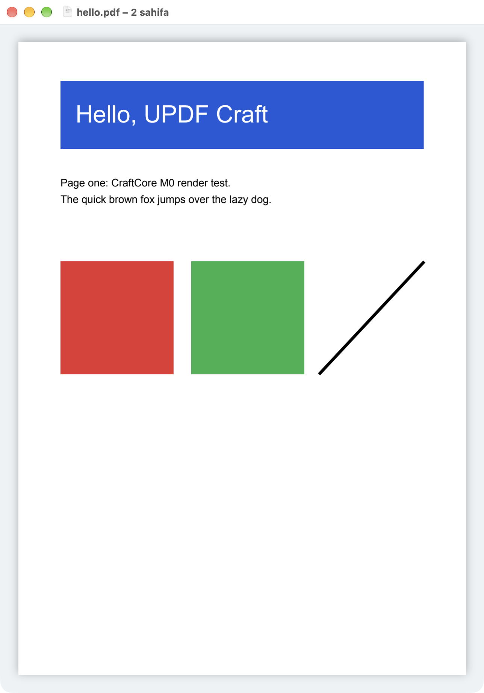

# UPDF Craft — yig'ish yo'riqnomasi (M0)

Bu hujjat [APPKIT_NATIVE_PLAN.md](../APPKIT_NATIVE_PLAN.md) §4 M0 va §7 bo'yicha qurilgan
poydevorni noldan yig'ishni tushuntiradi: PDFium + `craftcore` (C API) → `harness` CLI →
`CraftCore.xcframework` → `CraftKit` Swift package → `UPDFCraft` AppKit ilovasi.

Sinalgan muhit: macOS 27 (arm64), Xcode 27.0 beta (Swift 6.4), Python 3.15, XcodeGen.
PDFium revisiyasi: [`Engine/PDFIUM_REVISION`](../Engine/PDFIUM_REVISION)
(`7c55203e…`, 2026-10-15).

---

## 1. Talablar

| Nima | Izoh |
|---|---|
| macOS 14+ va Xcode (macOS SDK bilan) | `xcode-select -p` Xcode'ga ishora qilishi kerak |
| `git`, `python3` | depot_tools va gclient uchun |
| [XcodeGen](https://github.com/yonaskolb/XcodeGen) | `brew install xcodegen` — `.xcodeproj` shu bilan yaratiladi |
| Disk: ~4 GB | checkout ~2.2 GB (sync paytida vaqtincha ~3.7 GB), har bir `out/` ~60 MB, DerivedData ~200 MB |
| Internet | birinchi `gclient sync` uchun |

`ninja` va `gn` alohida o'rnatilmaydi — PDFium checkout ichidagi nusxalari ishlatiladi
(`buildtools/mac/gn`, `third_party/ninja/ninja`).

---

## 2. Tezkor yo'l (hammasi bir joyda)

```bash
Engine/scripts/sync_pdfium.sh
```
```bash
Engine/scripts/build_pdfium.sh arm64
```
```bash
Engine/scripts/build_pdfium.sh x64
```
```bash
Engine/scripts/build_xcframework.sh
```
```bash
Engine/scripts/smoke_test.sh arm64
```
```bash
(cd Packages/CraftKit && swift test)
```
```bash
(cd App && xcodegen generate && xcodebuild -project UPDFCraft.xcodeproj -scheme UPDFCraft -configuration Debug -derivedDataPath ../build/DerivedData build)
```
```bash
open -a "$PWD/build/DerivedData/Build/Products/Debug/UPDFCraft.app" Tests/corpus/hello.pdf
```

`x64` qadami ixtiyoriy: u bo'lsa xcframework universal (arm64 + x86_64) bo'ladi,
bo'lmasa faqat arm64.

---

## 3. Qadamlar batafsil

### 3.1 PDFium checkout — `sync_pdfium.sh`

Skript:

1. `Engine/depot_tools`ga depot_tools'ni klon qiladi (yo'q bo'lsa);
2. [`Engine/.gclient`](../Engine/.gclient) bo'yicha `gclient sync --no-history --shallow
   --revision pdfium@<PDFIUM_REVISION>` bajaradi;
3. `third_party/rust-toolchain`ni o'chiradi (pastga qarang);
4. o'z kodimizni PDFium daraxtiga symlink qiladi (`link_into_pdfium.sh`, §4.1).

`.gclient`dagi tanlovlar:

| Sozlama | Nega |
|---|---|
| `"checkout_configuration": "minimal"` | V8, Skia, test korpusi yuklanmaydi |
| `--no-history --shallow` | git tarixisiz — checkout bir necha barobar kichik |

DEPS rust toolchain'ni GCS dep sifatida shartsiz yuklaydi (~250 MB yuklab olinadi,
diskda ~1.5 GB). gclient `custom_deps`ni GCS dep'larga qo'llamaydi va uni o'chiradigan
DEPS o'zgaruvchisi yo'q, shuning uchun skript sync'dan keyin papkani o'chiradi
(`enable_rust=false` bilan u kerak emas). Sync paytida vaqtincha ~1.5 GB qo'shimcha joy
kerak bo'ladi.

PDFium'ni yangilash: `Engine/PDFIUM_REVISION`ga yangi commit yozib, skriptni qayta
ishga tushiring, keyin `build_pdfium.sh` va testlar.

### 3.2 PDFium + craftcore + harness — `build_pdfium.sh <arm64|x64> [debug]`

`Engine/pdfium/out/craft-<cpu>/args.gn` yoziladi, so'ng:

```bash
buildtools/mac/gn gen out/craft-arm64 --root-target=//craftcore
```
```bash
third_party/ninja/ninja -C out/craft-arm64 craftcore harness
```

`--root-target=//craftcore` — gn PDFium'ning `//BUILD.gn`i o'rniga bizning
`//craftcore/BUILD.gn`dan boshlaydi; PDFium manbasiga patch kerak emas.

gn argumentlari:

| Argument | Qiymat | Sabab |
|---|---|---|
| `pdf_is_standalone` | `true` | Chromium'siz mustaqil yig'ish |
| `is_component_build` | `false` | hammasi statik |
| `pdf_enable_v8` / `pdf_enable_xfa` | `false` | JavaScript va XFA M0'da kerak emas (reja: "V8 — keyin") |
| `use_custom_libcxx` | `false` | Apple libc++ bilan — Swift/Xcode tomoni bilan bir xil ABI |
| `target_cpu` | `"arm64"` / `"x64"` | |
| `is_debug` | `false` (yoki `debug` argumenti bilan `true`) | |
| `pdf_use_partition_alloc` | `false` | ilovaga joylashtirishda oddiy `malloc` |
| `pdf_use_skia` | `false` | AGG renderer (standart) |
| `enable_rust` | `false` | rust toolchain yuklanmagan |
| `symbol_level` | `0` | kichik arxiv va tez link |
| `mac_deployment_target` | `"14.0"` | reja: minimal macOS 14 |
| `clang_unsafe_buffers_paths` | `""` | §5.1 ga qarang |
| `use_remoteexec`, `use_siso` | `false` | lokal ninja |

Natija (arm64, M1+ da ~2–3 daqiqa):
- `out/craft-arm64/obj/craftcore/libcraftcore.a` — **complete static lib** (~17 MB):
  PDFium, FreeType, HarfBuzz, ICU, libjpeg-turbo, OpenJPEG, lcms va boshqalar ichida;
- `out/craft-arm64/craft-harness` — CLI.

### 3.3 harness

```bash
Engine/pdfium/out/craft-arm64/craft-harness open Tests/corpus/hello.pdf
```
```bash
Engine/pdfium/out/craft-arm64/craft-harness render Tests/corpus/hello.pdf --page 1 --scale 2 out.png
```
```bash
Engine/pdfium/out/craft-arm64/craft-harness text Tests/corpus/hello.pdf
```

- Sahifa raqamlari **1 dan** boshlanadi.
- `render` qo'shimcha parametrlari: `--annots` (annotatsiyalar bilan), `--tile X,Y,W,H`
  (to'liq sahifa bitmap'idagi piksel hudud — tile render'ni sinash uchun),
  `--password P`.
- harness faqat `craftcore.h`ni ishlatadi — ilova ko'radigan API bilan bir xil.
- Xatoda chiqish kodi `1`, noto'g'ri argumentda `2`.

`Engine/scripts/smoke_test.sh [cpu]` shu buyruqlarni korpus ustida tekshiradi.

### 3.4 CraftCore.xcframework — `build_xcframework.sh`

Mavjud slice'larni (`out/craft-arm64`, `out/craft-x64`) `lipo` bilan universal arxivga
birlashtiradi, `craftcore.h` va `module.modulemap` (`module CraftCore`) qo'shadi va
`Packages/CraftKit/Artifacts/CraftCore.xcframework`ga yozadi. Bu papka git'ga kirmaydi —
har bir ishlab chiquvchi o'zi yig'adi.

### 3.5 CraftKit (Swift package)

```bash
cd Packages/CraftKit && swift test
```

- `binaryTarget CraftCore` → `Artifacts/CraftCore.xcframework`.
- Linker: `libc++`, `AppKit`, `CoreFoundation`, `CoreGraphics`, `CoreText`.
- `EngineActor` — `@globalActor`; executor'i o'z `DispatchSerialQueue`si (macOS 14+),
  shuning uchun barcha `CC_*` chaqiruvlar bitta serial navbatda. Tashqariga faqat
  `Sendable` qiymatlar chiqadi (`DocumentID`, `OpenedDocument`, `CGImage`).
- `runBlocking` — `NSDocument.read(from:ofType:)` kabi sinxron API'lar uchun ko'prik.
- Testlar (Swift Testing): geometriya, `/Rotate`, piksel ranglari, tile = to'liq sahifa
  bo'lagi, matn, xato kodlari, sinxron ko'prik.

### 3.6 UPDFCraft ilovasi

```bash
cd App && xcodegen generate
```

Universal (arm64 + x86_64) Release:

```bash
xcodebuild -project UPDFCraft.xcodeproj -scheme UPDFCraft -configuration Release -destination 'generic/platform=macOS' -derivedDataPath ../build/DerivedData build
```

Loyihaning manbasi — [`App/project.yml`](../App/project.yml); `UPDFCraft.xcodeproj` undan
generatsiya qilinadi (repo'da ham saqlanadi, lekin qo'lda tahrirlamang). Xcode'da ochib
⌘R bilan ishga tushirish mumkin.

- `AppDelegate` (`@main`) — storyboard'siz, menyu kodda (`MainMenu`).
- `CraftDocument: NSDocument` — Info.plist'da `com.adobe.pdf`, role `Viewer`.
- `DocumentWindowController` — native window tabbing.
- `CanvasViewController` — `NSScrollView` (magnification) + `PageView`
  (layer-backed, bitmap `CALayer.contents`da). Zoom yoki oyna o'lchami o'zgarishi tugagach
  sahifa `backingScaleFactor × magnification` masshtabda qayta chiziladi.
- Imzo: "Sign to Run Locally" (`CODE_SIGN_IDENTITY = -`), Hardened Runtime yoqilgan,
  sandbox yo'q (reja: avval Developer ID, sandbox varianti keyin).

---

## 4. Repozitoriy tuzilmasi

```
updf-craft/
├ .github/workflows/ci.yml    # CI (§6)
├ Engine/
│  ├ .gclient                 # gclient konfiguratsiyasi (minimal)
│  ├ PDFIUM_REVISION          # qadalgan PDFium commit
│  ├ include/craftcore.h      # yagona ommaviy C API
│  ├ craftcore/               # //craftcore — C++ qatlam + BUILD.gn
│  ├ harness/                 # //craftcore_harness — CLI
│  ├ scripts/                 # sync, build, xcframework, smoke test
│  ├ depot_tools/             # (git'da emas)
│  └ pdfium/                  # (git'da emas) gclient checkout
├ Packages/CraftKit/          # Swift package (+ Artifacts/, git'da emas)
├ App/                        # project.yml, UPDFCraft.xcodeproj, UPDFCraft/
├ Tests/corpus/               # sintetik PDF'lar + make_corpus.py
└ docs/BUILD.md
```

### 4.1 Nega symlink

PDFium gclient checkout'i git submodule emas, uni "fork" sifatida saqlash hozircha shart
emas: `link_into_pdfium.sh` uchta symlink yaratadi —
`pdfium/craftcore → ../craftcore`, `pdfium/craftcore_harness → ../harness`,
`pdfium/craftcore_include → ../include`. Shunda o'z kodimiz bizning repo'da yashaydi,
gn esa uni PDFium daraxti ichidagidek ko'radi (bir xil flag'lar, `//` include yo'li —
M5'da PDFium ichki C++ sinflari uchun kerak). PDFium manbasiga patch kerak bo'lganda
`Engine/patches/` qo'shiladi va `sync_pdfium.sh` ularni qo'llaydi.

---

## 5. Ma'lum muammolar va qarorlar

### 5.1 `-Wunsafe-buffer-usage` (`clang_unsafe_buffers_paths=""`)
Upstream PDFium unsafe-buffers tekshiruvini Chromium libc++ bilan (bounded iterator'lar)
ishlatadi. `use_custom_libcxx=false` bilan `std::array` iteratorlari xom pointer bo'lib
qoladi va `core/fpdfapi/page/cpdf_psengine.cpp` `-Werror` bilan yiqiladi. Shuning uchun
tekshiruv o'chirilgan. O'z fayllarimizda `#pragma allow_unsafe_buffers` ham bor — tekshiruv
yoqilsa ham C chegarasi yig'iladi.

### 5.2 `-Wexit-time-destructors`
Chromium flag'lari bilan global/thread_local `std::string` ruxsat etilmaydi — xato xabari
`thread_local char[512]`da saqlanadi.

### 5.3 NSDocument concurrent reading o'chiq
`canConcurrentlyReadDocuments = true` bo'lsa AppKit `-[NSDocument init]`ni fon thread'ida
chaqiradi, Swift 6 esa subclass init'ini main actor'ga bog'laydi →
`dispatch_assert_queue` crash. Hozir hujjat main thread'da sinxron ochiladi
(`EngineActor.runBlocking`); PDFium faylni dangasa ochgani uchun bu qisqa. Katta
hujjatlar uchun M1'da: `read` faqat URL'ni saqlaydi, ochish esa oyna paydo bo'lgach asinxron.

### 5.4 Oyna o'lchami "qaytib keladi"
Bu xato emas: macOS state restoration oxirgi oyna ramkasini tiklaydi. Toza holatda sinash
uchun ilovani `-ApplePersistenceIgnoreState YES` bilan ishga tushiring.

### 5.5 x86_64
`build_pdfium.sh x64` arm64 Mac'da cross-compile qiladi; `craft-harness` x64 nusxasi
Rosetta orqali ishlaydi (`smoke_test.sh x64`).

---

## 6. CI (GitHub Actions)

[`.github/workflows/ci.yml`](../.github/workflows/ci.yml) — `push` (main), `pull_request`
va qo'lda (`workflow_dispatch`) ishga tushadi. Bitta job, `macos-15` (arm64) runner:

1. **PDFium keshi** (`actions/cache`): `Engine/pdfium` (`out/`siz), `Engine/depot_tools`,
   `.gclient_entries`, `.gcs_entries`. Kalit — `Engine/PDFIUM_REVISION` va `Engine/.gclient`
   hash'i: revisiya o'zgarsa kesh yangidan quriladi.
2. Kesh bo'lmasa — `sync_pdfium.sh`.
3. `build_pdfium.sh arm64` → `smoke_test.sh arm64` → `build_xcframework.sh`.
4. `swift test` (`Packages/CraftKit`).
5. `xcodegen generate` + `git diff --exit-code`: commit qilingan `UPDFCraft.xcodeproj`
   `project.yml` bilan mos ekanini tekshiradi (generatsiya deterministik).
6. `xcodebuild` (Debug, `CODE_SIGNING_ALLOWED=NO`).

Lokal tekshiruv: `actionlint .github/workflows/ci.yml`. Har bir qadam §2 dagi buyruqlar
bilan bir xil, shuning uchun CI'dagi xatoni lokal takrorlash oson.

Cheklovlar:
- Runner'dagi Xcode versiyasi GitHub image'iga bog'liq ("Muhit" qadami uni chiqaradi);
  loyiha Swift 6.0 va macOS 14 SDK'dan yuqorisini talab qilmaydi.
- Kesh ~2.5 GB; GitHub repo bo'yicha 10 GB limit bor. Birinchi (keshsiz) ishga tushish
  sync tufayli uzoqroq.
- x86_64 slice CI'da yig'ilmaydi (vaqtni tejash uchun); kerak bo'lsa
  `build_pdfium.sh x64` qadamini qo'shing.

---

## 7. Keyingi qadamlar

- M1: `CanvasScrollView` continuous rejim, tile render (`CC_Render_Rect` tayyor),
  prefetch va bekor qilish, matn tanlash.
- Hujjatni asinxron ochish (§5.3).


